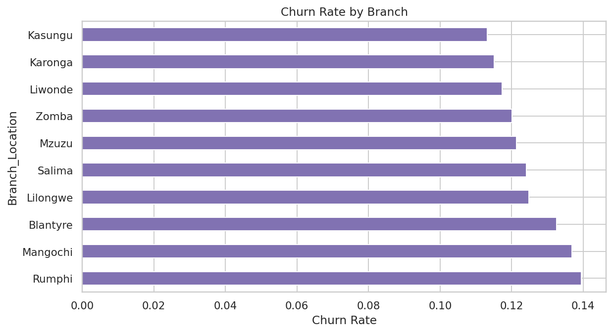
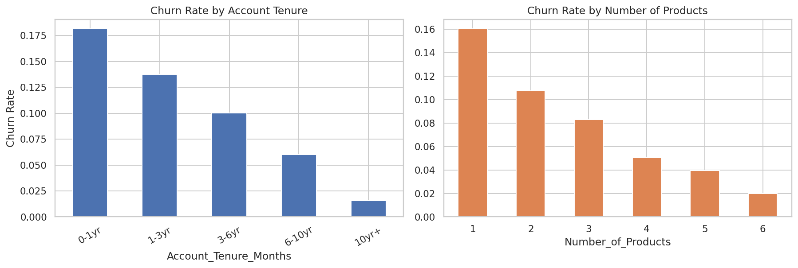

# Banking Customer Churn Analysis and Prediction

## Customer Analytics, Churn Prediction & Retention Strategy

A rigorous, reproducible customer churn prediction project with a modular codebase, comprehensive testing, and business-oriented analysis.

## Quick Start

```bash
# Install dependencies
pip install -r requirements.txt

# Generate synthetic data
python scripts/generate_dataset.py

# Train the model (reproducible pipeline)
python scripts/train_pipeline.py

# Run tests
pytest tests/ -v

# Launch prediction interface
streamlit run app.py

# Launch the interactive retention command centre
streamlit run dashboard/streamlit_command_centre.py
```

## Project Overview

This project builds a complete customer-churn analytics workflow around a Malawi-focused commercial banking scenario. It features:

- **Modular, reusable code** in `src/` with separate modules for data validation, feature engineering, modeling, explainability, and retention recommendations
- **Leakage-safe feature engineering** using training-set-only statistics
- **Comprehensive evaluation** with baseline comparison, calibration analysis, and capacity-constrained threshold selection
- **Model explainability** via permutation importance and rule-based reason codes
- **Validated risk bands** with observed churn rates on held-out test data
- **Retention recommendation framework** with actionable priority levels
- **Automated pytest suite** covering data validation, feature engineering, model behaviour, dataset reproducibility and retention risk boundaries
- **GitHub Actions CI** for automated testing
- **Streamlit prediction interface** for single and batch predictions
- **Interactive retention command centre** for executive monitoring, customer intelligence, outreach prioritisation, batch scoring and model governance
- **Power BI dashboard specification** for business stakeholders

## Model Performance (Test Set)

| Metric | Baseline | Logistic Regression | Random Forest |
|--------|----------|---------------------|---------------|
| Accuracy | 0.8745 | 0.6777 | 0.7508 |
| Precision | 0.0000 | 0.2271 | 0.2632 |
| Recall | 0.0000 | **0.6529** | 0.5478 |
| F1 Score | 0.0000 | 0.3370 | 0.3556 |
| ROC-AUC | 0.5000 | **0.7417** | 0.7307 |

**Selected model: Logistic Regression** for higher recall (65.3% vs 0% baseline), meaning it can identify 65% of customers who will churn.

### Risk Band Calibration (Test Set)
- **Low Risk:** 3.9% observed churn rate
- **Medium Risk:** 12.1% observed churn rate  
- **High Risk:** 33.1% observed churn rate

### Permutation Importance (Top 5)
1. Days_Since_Last_Transaction: 7.4%
2. Account_Tenure_Months: 5.3%
3. Number_of_Complaints: 4.1%
4. Number_of_Products: 2.9%
5. Average_Monthly_Deposit: 1.0%

## Key Findings

1. **Recency is the strongest predictor** - churn rises from 7.5% to 21.7% across days-since-last-transaction quartiles
2. **Complaints show the steepest gradient** - churn rises from 9.9% (no complaints) to 47.6% (4+ complaints)
3. **Product count is protective** - single-product customers churn at 16.0% vs 1.7% for customers with 6 products
4. **Customer value and churn risk are independent** - high-balance customers churn at 12.53%, essentially identical to the 12.55% overall rate
5. **Risk bands are well-calibrated** - observed churn rates increase monotonically across Low/Medium/High bands

## Repository Structure

```
banking-customer-churn-analysis/
├── src/                          # Modular source code
│   ├── __init__.py
│   ├── data_validation.py       # Schema checks, data quality validation
│   ├── feature_engineering.py   # Leakage-safe feature engineering
│   ├── modeling.py              # Pipeline, evaluation, model comparison
│   ├── explainability.py        # Permutation importance, explanations
│   └── retention.py             # Risk bands, retention recommendations
├── scripts/
│   ├── generate_dataset.py      # Reproducible synthetic data generator
│   └── train_pipeline.py        # End-to-end training orchestration
├── tests/                        # Automated unit and regression tests
│   ├── __init__.py
│   ├── test_data_validation.py
│   ├── test_feature_engineering.py
│   ├── test_modeling.py
│   ├── test_dataset_generation.py
│   └── test_retention.py
├── data/
│   ├── raw/                      # Generated by generate_dataset.py
│   └── processed/                # Cleaned data and predictions
├── models/                       # Trained models with metadata
├── sql/                          # Analysis queries
├── dashboard/                     # Streamlit command centre and Power BI guide
│   ├── streamlit_command_centre.py
│   └── powerbi_dashboard_guide.md
├── app.py                        # Streamlit prediction interface
├── requirements.txt
├── REPRODUCIBILITY.md            # Detailed reproducibility guide
├── .github/workflows/ci.yml      # GitHub Actions CI
└── README.md
```

## Installation

```bash
git clone <this-repo>
cd banking-customer-churn-analysis
pip install -r requirements.txt
```

## Usage

### Generate Synthetic Data
```bash
python scripts/generate_dataset.py
```
Creates `data/raw/churn_customers_synthetic.csv` with 20,000 base customer records and repeatable data-quality issues, including approximately 1% duplicate rows (20,200 records by default).

### Train Model
```bash
python scripts/train_pipeline.py
```

The pipeline writes the trained model, cleaned customer cohort, held-out test predictions and full-population customer scores to the repository's `models/` and `data/processed/` directories.
This script:
- Loads and validates data
- Cleans data (removes duplicates, fixes outliers)
- Performs leakage-safe feature engineering
- Compares baseline, logistic regression, and random forest
- Trains selected model (logistic regression)
- Evaluates on test set
- Generates threshold and capacity analysis
- Runs explainability analysis
- Creates retention analysis
- Saves model, predictions, and cleaned data

### Run Tests
```bash
pytest tests/ -v
```

### Prediction Interface
```bash
streamlit run app.py
```
Provides:
- Single customer prediction with risk factors
- Batch prediction from CSV upload
- Model information display

### Retention Command Centre

The training pipeline exports separate held-out test predictions for evaluation and full-population customer scores for portfolio monitoring. The dashboard uses the full-population score file so the retention queue is not restricted to the test split. Full-population scores are generated by a model that has seen the training portion of the cohort; use the held-out metrics for independent performance assessment.

Launch the interactive portfolio workspace:

```bash
streamlit run dashboard/streamlit_command_centre.py
```

It includes five workspaces:
- **Executive Overview:** portfolio size, observed churn, risk distribution, high-risk balance exposure and branch/segment comparisons.
- **Customer Intelligence:** customer-level filtering and behavioural analysis.
- **Retention Prioritisation:** capacity-constrained outreach ranking, recommended next-best actions and CSV export.
- **Prediction Lab:** batch scoring for new customer CSV files.
- **Model Governance:** held-out model metrics and responsible-use guidance.

All monetary values are displayed in Malawi Kwacha (MWK). The existing `app.py` prediction interface remains available.

## Visual Analysis

The repository includes exported analytical charts that can be viewed directly in GitHub:







### SQL Analysis
```bash
cd sql
sqlite3 churn_analysis.db < analysis_queries.sql
```

## Data note

Customer records and outcomes are generated for a controlled banking analytics demonstration; they do not represent real customer accounts or operational bank records. Nyanja Commercial Bank and the named branches provide context for the scenario.

## Data Quality Issues (Deliberately Injected)

- Missing income (~2%), marital status (~1.5%), internet banking flags (~1.5%)
- Duplicate records (~1%)
- Inconsistent segment labels (~1.5%)
- Implausible ages (values outside 18-90, ~0.2%)
- Extreme income outliers (10-20x, ~0.3%)
- Negative transaction counts (~0.3%)

All issues are handled explicitly in the cleaning pipeline with no silent corrections.

## Preventing Data Leakage

Feature engineering uses **training-set-only statistics** to prevent leakage:
- Quartiles for flags are computed on training data only
- Normalization parameters are fit on training data only
- No test set information is used during training

## Feature Engineering

| Feature | Definition | Banking Meaning |
|---------|------------|-----------------|
| Average_Transaction_Value | Total 6-month value ÷ (monthly transactions × 6) | Typical transaction size |
| Transaction_Activity_Index | Monthly transactions ÷ (days since last transaction + 1) | Combined activity and recency |
| Digital_Banking_Usage | Mobile + internet banking flags (0/1/2) | Digital channel adoption breadth |
| Complaint_Rate | Complaints ÷ years of tenure | Complaints per year of relationship |
| Engagement_Index | Average of scaled digital score and normalized activity | Composite engagement measure |
| Balance_to_Income_Ratio | Balance ÷ income | Share of financial life at this bank |
| Products_per_Tenure | Products ÷ years of tenure | Product adoption rate |
| Recent_Activity_Flag | 1 if inactive ≤30 days | Actionable recency cutoff |
| High_Value_Customer_Flag | 1 if balance in top quartile | High-value customer flag |
| Low_Engagement_Flag | 1 if digital score < 40 | Digital-risk flag |

## Threshold Analysis

| Threshold | Precision | Recall | F1 | Customers Flagged |
|-----------|-----------|--------|-----|------------------|
| 0.30 | 0.158 | 0.927 | 0.270 | 73.5% |
| 0.40 | 0.188 | 0.814 | 0.305 | 54.5% |
| 0.50 | 0.227 | 0.653 | 0.337 | 36.1% |
| 0.60 | 0.293 | 0.505 | 0.371 | 21.6% |
| 0.70 | 0.369 | 0.328 | 0.347 | 11.2% |

**Recommendation:** Threshold 0.30-0.40 is more defensible for retention programs where missed churners are more costly than false positives.

## Capacity Analysis

| Capacity | Precision | Recall | F1 |
|----------|-----------|--------|-----|
| 100 | 67.0% | 10.7% | 18.4% |
| 500 | 38.8% | 30.9% | 34.4% |
| 1000 | 29.3% | 46.7% | 36.0% |
| 2000 | 21.7% | 69.1% | 33.0% |

## Retention Recommendations

| Risk + Profile | Recommended Action | Priority |
|----------------|-------------------|----------|
| High Risk + High Balance | Priority relationship manager check-in | Critical |
| High Risk + Multiple Complaints | Customer service intervention | High |
| High Risk + High Inactivity | Relationship manager outreach | High |
| High Risk + Low Products | Product education/cross-sell | Medium |
| High Risk + Low Digital | Digital banking support session | Medium |
| Medium Risk | Monitor - no immediate action | Low |
| Low Risk | No action needed | None |

## Power BI Dashboard

See `dashboard/powerbi_dashboard_guide.md` for the complete specification. A runnable Streamlit command centre is also provided in `dashboard/streamlit_command_centre.py`. The Power BI guide includes:
- 6 pages: Executive Overview, Customer Profile, Churn Drivers, High-Risk Customers, Capacity Analysis, Threshold Analysis
- DAX measures for key metrics
- Data model and refresh strategy
- Key findings to highlight

## Technologies Used

- **Python:** pandas, numpy, scikit-learn, joblib, streamlit, pytest
- **SQL:** SQLite with CTEs and window functions
- **CI:** GitHub Actions
- **Dashboard:** Power BI (specification)

## Reproducibility

See `REPRODUCIBILITY.md` for detailed instructions. Key points:
- Fixed random seed (42) for data generation
- Fixed random_state (42) for model training
- All dependencies pinned in requirements.txt
- Automated tests verify code correctness

## Limitations

- Cross-sectional synthetic snapshot, not real historical data
- No genuine time dimension for trend analysis
- Model performance on real data would likely differ
- Prediction does not establish causation
- Findings should be validated with controlled experiments before business action

## Ethical Considerations

This project uses synthetic data for educational purposes. In real deployments, churn models require:
- Customer privacy and data protection
- Avoidance of discriminatory outcomes
- Human review before customer-facing actions
- Ongoing monitoring and revalidation

**This project does not recommend automatically closing accounts, denying services, or taking punitive action based on churn predictions.**

## Author

Chico Mkandawire
MSc Data Science, Malawi University of Science and Technology (in progress)
BSc Management Information Systems, Malawi University of Business and Applied Sciences
