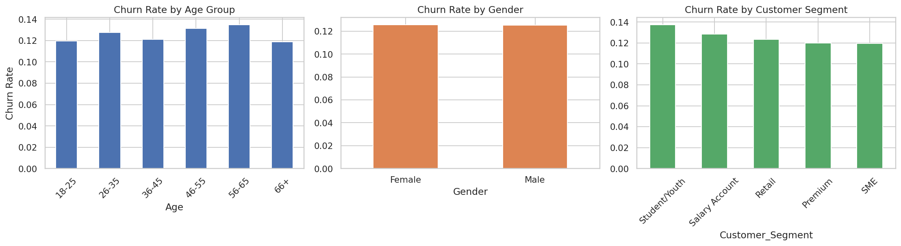
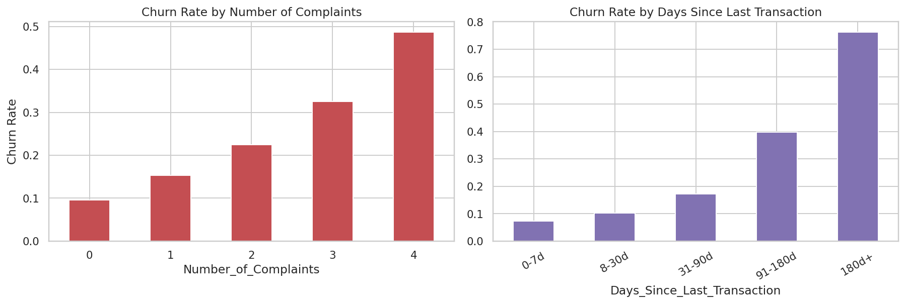
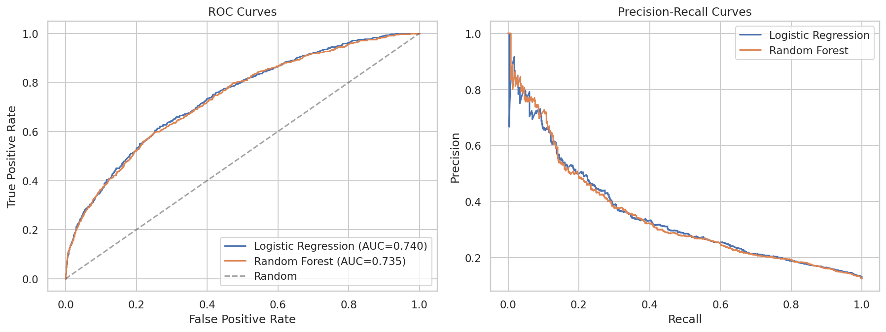
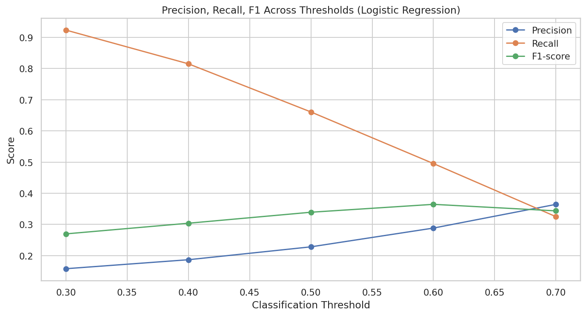

# Banking Customer Churn Intelligence & Retention Strategy

A complete customer analytics and machine-learning project built around a Malawi-focused commercial banking scenario. The work connects exploratory analysis, leakage-aware modelling, customer-level risk scoring and a practical retention workflow.

<p align="center">
  <a href="https://banking-customer-churn-command-centre.streamlit.app/"><strong>Launch the Live Command Centre →</strong></a>
</p>

<p align="center">
  
  
  
  
  
</p>

---

## The business problem

Customer attrition reduces recurring revenue, weakens customer relationships and increases the cost of replacing lost customers. Banking teams need more than a probability score: they need to understand where risk is concentrated, which customers merit attention and how limited relationship-team capacity should be allocated.

This project develops an end-to-end analytical workflow to support those decisions. It combines customer profiling, churn modelling, explainability, risk segmentation and a capacity-aware retention worklist.

## Explore the project

| Experience | What it offers |
|---|---|
| [Live retention command centre](https://banking-customer-churn-command-centre.streamlit.app/) | Executive overview, customer intelligence, retention prioritisation, prediction lab and model governance |
| [Source code](https://github.com/MkandawireChico/-Banking-Customer-Churn-Analysis-and-Prediction/tree/main/src) | Reusable validation, feature engineering, modelling, explainability and retention modules |
| [Analysis visuals](visuals/charts/) | Exploratory analysis, model evaluation, threshold trade-offs and feature importance |
| [Power BI dashboard guide](dashboard/powerbi_dashboard_guide.md) | Six-page stakeholder dashboard specification, measures and data model |
| [Reproducibility guide](REPRODUCIBILITY.md) | Environment setup, deterministic runs and artefact generation |
| [Project walkthrough](docs/PROJECT_WALKTHROUGH.md) | Architecture, decision workflow, interpretation and limitations |

## Command centre

The Streamlit application is designed as a banking operations workspace rather than a static model demo.

- **Executive Overview** — portfolio KPIs, churn distribution, risk exposure, branch and segment comparisons, inactivity analysis and a priority watchlist.
- **Customer Intelligence** — interactive segment, branch and risk filters; behavioural analysis; customer-level exploration; filtered export.
- **Retention Prioritisation** — configurable outreach capacity, risk eligibility, ranked worklist, recommended actions and downloadable CSV.
- **Prediction Lab** — upload a customer CSV, score records with the trained pipeline and export risk assessments.
- **Model Governance** — held-out validation metrics, threshold trade-offs and responsible-use controls.

All financial values are presented in Malawi Kwacha (MWK).

## Model performance

The training workflow compares a majority-class baseline, Logistic Regression and Random Forest on a validation split drawn only from the training partition. The final test partition is reserved for the selected candidate's independent evaluation.

Logistic Regression remains the initial operating candidate because the retention-screening use case places value on identifying a larger share of potential churners. This is not a claim that it is universally superior: Random Forest can achieve stronger precision or F1, and the validation scorecard exposes the trade-offs. Average precision, recall, precision, F1, Brier score and log loss should be considered together.

The production pipeline applies sigmoid probability calibration using five-fold cross-validation within the training partition. Neither the validation rows nor the final test rows are used to fit the calibrator. Calibration quality is then measured on the independent test set using Brier score, log loss, a calibration curve and expected calibration error (ECE). A high ECE is surfaced as a governance warning: scores should then be treated as relative prioritisation signals rather than precise individual probabilities.

The operating model and threshold should ultimately be selected using the bank's intervention costs, the cost of missed churners and available relationship-team capacity—not accuracy alone.
### Risk-band validation

| Risk band | Observed churn rate on test set |
|---|---:|
| Low | 3.9% |
| Medium | 12.1% |
| High | 33.1% |

The observed rates increase across the risk bands, supporting their use as a prioritisation aid. They are not guarantees about an individual customer's future behaviour.

## Selected analytical findings

- **Transaction recency matters:** churn increases from 7.5% to 21.7% across days-since-last-transaction quartiles.
- **Complaints are an important warning signal:** observed churn rises from 9.9% among customers with no complaints to 47.6% among customers with four or more.
- **Deeper product relationships are associated with lower churn:** single-product customers show 16.0% churn compared with 1.7% among customers with six products.
- **Balance alone is not a reliable risk proxy:** high-balance customers show a churn rate close to the overall rate in this dataset.
- **Risk bands separate observed outcomes:** the held-out churn rate rises monotonically from low to high risk.

These are associations in the analysed cohort, not causal claims. The relationship between product holdings, complaints, inactivity and churn should be tested further before designing interventions.

## Visual analysis

The repository contains a set of exported charts to make the analysis reviewable directly from GitHub.

### Customer behaviour

<p align="center">
  
  
</p>
<p align="center">
  
  
</p>

### Model evaluation and decision support

<p align="center">
  
  
</p>
<p align="center">
  
</p>

## Technical approach

1. **Data generation and quality** — create a reproducible customer cohort and inject known data-quality issues for validation.
2. **Validation and cleaning** — inspect schema, missingness, duplicates, inconsistent categories and implausible values.
3. **Feature engineering** — build banking-relevant behavioural features while fitting learned transformations on training data only.
4. **Model development** — compare a majority baseline, Logistic Regression and Random Forest.
5. **Evaluation** — assess discrimination, precision/recall trade-offs, threshold behaviour and calibration.
6. **Explainability** — use permutation importance and customer-level reason codes to support interpretation.
7. **Retention workflow** — assign risk bands, rank eligible customers and create capacity-constrained outreach lists.
8. **Deployment** — expose portfolio analysis and batch scoring through Streamlit.

## Repository structure

```text
├── app.py                         # Single/batch prediction interface
├── dashboard/
│   ├── streamlit_command_centre.py # Multi-workspace retention application
│   └── powerbi_dashboard_guide.md # Power BI implementation specification
├── data/
│   ├── raw/                       # Generated source cohort
│   └── processed/                 # Clean profiles and scoring exports
├── docs/                          # Project walkthrough and documentation
├── models/                        # Trained model and evaluation metadata
├── notebooks/                     # Exploratory analysis
├── scripts/
│   ├── generate_dataset.py         # Reproducible data generation
│   └── train_pipeline.py           # End-to-end training pipeline
├── sql/                            # SQL analysis queries
├── src/
│   ├── data_validation.py
│   ├── feature_engineering.py
│   ├── modeling.py
│   ├── explainability.py
│   └── retention.py
├── tests/                          # Automated tests
├── visuals/charts/                 # Exported analytical figures
├── requirements.txt
└── REPRODUCIBILITY.md
```

## Run locally

### 1. Set up the environment

```bash
git clone https://github.com/MkandawireChico/-Banking-Customer-Churn-Analysis-and-Prediction.git
cd -Banking-Customer-Churn-Analysis-and-Prediction
python -m venv .venv
# Activate the environment, then:
pip install -r requirements.txt
```

### 2. Generate data and train the pipeline

```bash
python scripts/generate_dataset.py
python scripts/train_pipeline.py
```

The pipeline generates the cleaned customer cohort, held-out test predictions, full-cohort customer scores, trained model and evaluation metadata.

### 3. Launch the application

```bash
streamlit run dashboard/streamlit_command_centre.py
```

The separate prediction interface can be launched with:

```bash
streamlit run app.py
```

### 4. Run quality checks

```bash
pytest tests/ -v
```

GitHub Actions also runs the automated checks across supported Python versions and performs a pipeline/dashboard smoke test.

## Reproducibility and evaluation boundaries

The training pipeline keeps two scoring purposes distinct:

- **Held-out test predictions** are used for independent model evaluation.
- **Full-population customer scores** support portfolio exploration and retention queue creation.

The full-population scoring file includes customers from the training portion of the cohort, so it must not be used to report independent model performance. Use the held-out test metrics for that purpose.

See [REPRODUCIBILITY.md](REPRODUCIBILITY.md) for the complete run procedure and generated artefacts.

## Responsible use and limitations

The customer records and outcomes are generated for this controlled banking analytics scenario. They are not real customer accounts or operational bank records. Nyanja Commercial Bank and its branch context provide a consistent setting for the analysis.

The project is a decision-support demonstration, not an automated customer treatment system. Before any real deployment:

- Validate performance on representative, authorised production data.
- Review fairness and error rates across relevant customer groups.
- Monitor data quality, drift, calibration and model performance over time.
- Test retention interventions through controlled experiments.
- Require human review before customer-facing action.

A churn score does not establish causation and must never be used on its own to deny services, close accounts or apply punitive treatment.

## Author

**Chico Mkandawire**  
MSc Data Science, Malawi University of Science and Technology (in progress)  
BSc Management Information Systems, Malawi University of Business and Applied Sciences

---

<p align="center">
  <strong>From customer data to retention decisions.</strong><br>
  <a href="https://banking-customer-churn-command-centre.streamlit.app/">Explore the live command centre</a>
</p>
