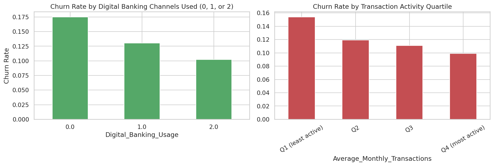
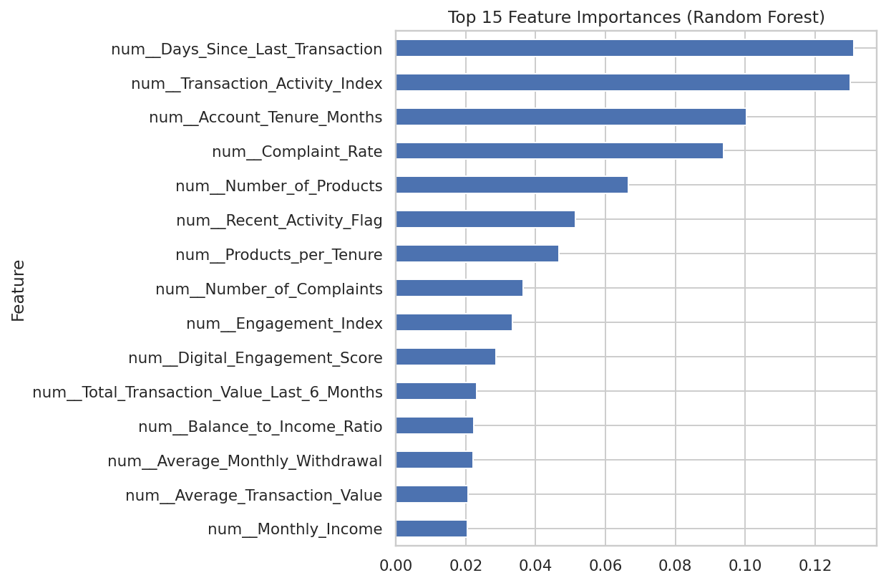

# Banking Customer Churn Analysis & Retention Strategy

An end-to-end banking analytics project focused on understanding customer attrition, identifying at-risk relationships and prioritising practical retention activity.

The project combines customer-level analysis, reproducible machine learning, explainability, SQL, automated tests and an interactive Streamlit command centre. Monetary values are expressed in **Malawi Kwacha (MWK)**.

## Project at a glance

| Workstream | Deliverable |
|---|---|
| Customer analytics | Demographic, product, branch and behavioural churn analysis |
| Data engineering | Quality checks, documented cleaning and reusable feature engineering |
| Predictive modelling | Logistic Regression and Random Forest comparison |
| Model evaluation | ROC-AUC, precision, recall, F1, calibration, threshold and capacity analysis |
| Explainability | Permutation importance and customer-level reason codes |
| Retention operations | Risk bands, prioritised outreach queue and next-best-action guidance |
| Business intelligence | Interactive Streamlit command centre and Power BI implementation guide |
| Engineering quality | Modular Python package, pytest suite and GitHub Actions |

## Interactive command centre

Launch the application from the repository root:

```bash
pip install -r requirements.txt
python scripts/generate_dataset.py
python scripts/train_pipeline.py
streamlit run dashboard/streamlit_command_centre.py
```

The workspace includes:
- **Executive Overview:** customer counts, observed churn, high-risk balance exposure, branch and segment comparisons, risk distribution and model validation.
- **Customer Intelligence:** filterable customer analysis by segment, branch and risk band.
- **Retention Prioritisation:** capacity-constrained outreach queue with suggested actions and CSV export.
- **Prediction Lab:** batch scoring for new customer files.
- **Model Governance:** held-out performance and practical model-use safeguards.

The original prediction interface remains available through `streamlit run app.py`.

## Model performance

The currently committed training artefact reports the following held-out test results. Re-run the pipeline to refresh these values after changing data, features or model settings.

| Metric | Majority baseline | Logistic Regression | Random Forest |
|---|---:|---:|---:|
| Accuracy | 0.8745 | 0.6777 | 0.7508 |
| Precision | 0.0000 | 0.2271 | 0.2632 |
| Recall | 0.0000 | **0.6529** | 0.5478 |
| F1 score | 0.0000 | 0.3370 | 0.3556 |
| ROC-AUC | 0.5000 | **0.7417** | 0.7307 |

Logistic Regression is retained as the operating model in the current pipeline because it has the higher recall of the two candidate models. The majority-class baseline illustrates why accuracy alone is not a useful selection criterion for this imbalanced problem.

### Risk-band validation

| Risk band | Observed churn rate |
|---|---:|
| Low | 3.9% |
| Medium | 12.1% |
| High | 33.1% |

Risk bands are probability groupings, not guarantees about an individual customer. Thresholds should be selected against intervention capacity, costs and measured outcomes.

## Selected analytical findings

1. **Recency matters:** churn rises across customer inactivity groups, making recent transaction behaviour a useful retention signal.
2. **Service friction matters:** customers with more complaints show materially higher observed churn.
3. **Relationship depth is relevant:** customers with more products show lower observed churn in this dataset.
4. **Customer value is not a substitute for risk:** balance should be considered alongside churn probability rather than used as a proxy for it.
5. **Capacity changes outcomes:** lowering the outreach threshold increases coverage but also increases the number of customers requiring contact.

## Visual analysis

The repository includes the following analysis outputs:







## Repository structure

```text
.
├── .github/workflows/       # Continuous integration
├── dashboard/
│   ├── streamlit_command_centre.py
│   └── powerbi_dashboard_guide.md
├── data/
│   ├── raw/                 # Reproducible source dataset
│   └── processed/           # Cleaned customer and prediction exports
├── models/                  # Trained model artefacts
├── notebooks/               # Exploratory analysis notebook
├── scripts/
│   ├── generate_dataset.py
│   └── train_pipeline.py
├── sql/                     # Business analysis queries and SQLite workspace
├── src/                     # Validation, features, modelling, explainability, retention
├── tests/                   # Automated unit tests
├── visuals/charts/          # Exported analytical charts
├── app.py                   # Single/batch prediction interface
├── requirements.txt
└── README.md
```

## Reproduce the analysis

Use Python 3.10 or newer.

```bash
git clone https://github.com/MkandawireChico/-Banking-Customer-Churn-Analysis-and-Prediction.git
cd -Banking-Customer-Churn-Analysis-and-Prediction
python -m pip install -r requirements.txt

# Generate the source customer dataset
python scripts/generate_dataset.py

# Validate, clean, train, evaluate and export model outputs
python scripts/train_pipeline.py

# Run automated tests
pytest tests/ -v

# Launch the interactive command centre
streamlit run dashboard/streamlit_command_centre.py
```

The generator writes to the repository's `data/raw/` directory regardless of the current working directory. Use `--seed`, `--rows` or `--output` to customise a run.

## SQL analysis

The `sql/` directory contains reusable queries for churn by segment, branch, customer behaviour and product holdings. See [SQL usage notes](sql/README.md) before running the queries against the included SQLite workspace.

## Methodology and responsible use

The included customer population is generated reproducibly to demonstrate a complete analytical workflow, including realistic data-quality challenges. The bank and customer records are illustrative, not operational banking records. The model's results should therefore be interpreted as a technical portfolio demonstration rather than evidence about a real institution.

The workflow separates training and test data, fits preprocessing within the training pipeline, and reports held-out performance. Predictions describe statistical risk, not causation or certainty. Human review, privacy safeguards, fairness checks, calibration monitoring and validation on representative real-world data are required before any operational use. No account restriction or adverse customer decision should be made automatically from a churn score.

## Documentation

- [Reproducibility guide](REPRODUCIBILITY.md)
- [Power BI dashboard implementation guide](dashboard/powerbi_dashboard_guide.md)
- [SQL analysis guide](sql/README.md)

## Author

**Chico Mkandawire**  
MSc Data Science (in progress), Malawi University of Science and Technology  
BSc Management Information Systems, Malawi University of Business and Applied Sciences
